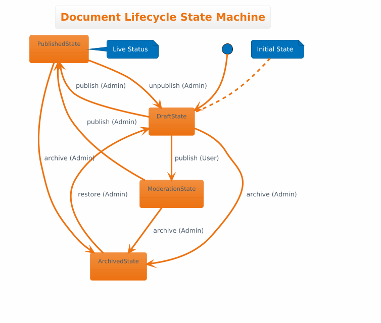

# Document Workflow - State Design Pattern

A Python-based implementation of a document management system using the **State Design Pattern**. This project demonstrates how to manage complex object behaviors by delegating state-specific logic to separate state classes, ensuring the `Document` context remains clean and maintainable.

## 🚀 Features

* **State-Driven Logic:** Transitions (Publish, Unpublish, Archive, Restore) are handled by concrete state classes.
* **Role-Based Access Control:** Actions are restricted based on user roles (`ADMIN` vs. `USER`).
* **Encapsulated Transitions:** A centralized `_transition_to` method ensures consistent state changes and easy debugging.
* **Comprehensive Testing:** Includes a suite of `pytest` unit tests covering valid transitions and guard conditions.

## 🛠 Project Structure

* `main.py`: Contains the `Document` (Context) class and the `State` (Abstract Base Class) with its concrete implementations.
* `test.py`: A full test suite using `pytest` to validate lifecycle transitions and security guards.

---

## 🔄 State Machine Logic

| Current State | Action | User Role | New State |
| --- | --- | --- | --- |
| **Draft** | Publish | USER | Moderation |
| **Draft** | Publish | ADMIN | Published |
| **Moderation** | Publish | ADMIN | Published |
| **Published** | Unpublish | ADMIN | Draft |
| **Any (except Archived)** | Archive | ADMIN | Archived |
| **Archived** | Restore | ADMIN | Draft |

---
## PlantUML Diagram

---

## 💻 Usage

```python
from main import Document

# Initialize document (Starts in DRAFT)
doc = Document()

# User logs in and submits for moderation
doc.login("USER")
doc.publish() 
print(f"Current Status: {doc.status}") # Output: MODERATION

# Admin logs in to finalize
doc.login("ADMIN")
doc.publish()
print(f"Current Status: {doc.status}") # Output: PUBLISHED

```

## 🧪 Running Tests

This project uses `pytest` for unit testing. To run the tests, ensure you have pytest installed:

```bash
pip install pytest

```

Then, execute the following command in the project directory:

```bash
pytest test.py

```

### Test Coverage

* **Valid Transitions:** Ensures documents move correctly between states (e.g., Draft to Moderation).
* **Guard Conditions:** Validates that `USER` roles cannot perform `ADMIN` actions like unpublishing or archiving.
* **Invalid Operations:** Confirms that impossible transitions (e.g., restoring a document that isn't archived) are ignored.

---

## 📖 Key Design Principles Used

1. **Open/Closed Principle:** You can add new states (e.g., `DeletedState`) without modifying the existing `Document` class or other state classes.
2. **Single Responsibility:** Each state class is only responsible for the logic associated with that specific status.
3. **Encapsulation:** The internal state object is protected (`_state`), and changes are managed via a controlled interface.
